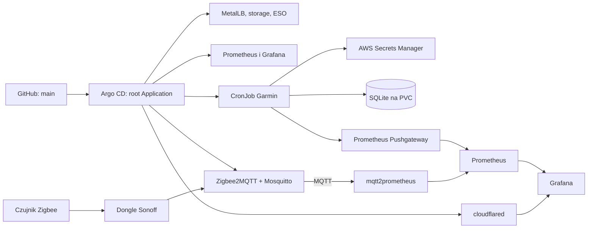

# HomeLab

Repozytorium opisuje domowe środowisko Kubernetes zarządzane deklaratywnie przez GitOps. Argo CD obserwuje gałąź `main`, wdraża aplikacje z manifestów Kustomize i utrzymuje stan klastra zgodny z konfiguracją w repozytorium.

## Przegląd

Projekt łączy podstawowe usługi klastra z aplikacją do pobierania danych Garmin oraz z systemem smart home opartym na Zigbee2MQTT i brokerze MQTT. MetalLB udostępnia usługi przez adresy z lokalnej puli LAN, Local Path Provisioner zapewnia lokalne wolumeny, a External Secrets Operator synchronizuje wybrane sekrety z AWS Secrets Manager. Prometheus zbiera metryki, które można przeglądać w Grafanie. Czujniki Zigbee publikują pomiary przez MQTT, a eksporter zamienia je na metryki Prometheusa. Cloudflare Tunnel pozwala bezpiecznie udostępnić Grafanę lub wybrany dashboard poza siecią domową.



## Technologie

| Technologia | Zastosowanie |
| --- | --- |
| Kubernetes / RKE2 | Uruchamianie usług klastra; instrukcje instalacji znajdują się niżej. |
| Argo CD | GitOps i automatyczna synchronizacja aplikacji z repozytorium. |
| Kustomize | Składanie manifestów Kubernetes. |
| MetalLB | Udostępnianie usług typu `LoadBalancer` w sieci LAN. |
| Rancher Local Path Provisioner | Lokalne wolumeny dla aplikacji. |
| External Secrets Operator | Synchronizacja sekretów z AWS Secrets Manager. |
| Prometheus i Grafana | Zbieranie oraz przeglądanie metryk. |
| Python i Garmin Connect Personal API | Pobieranie danych Garmin, zapis w SQLite i publikowanie metryk. |
| Zigbee2MQTT | Obsługa czujników Zigbee przez dongle USB Sonoff i publikowanie pomiarów w MQTT. |
| Mosquitto (MQTT) | Broker wiadomości MQTT z logowaniem; dane logowania pochodzą z AWS przez ESO. |
| mqtt2prometheus | Zamiana pomiarów z MQTT na metryki Prometheusa. |
| Cloudflare Tunnel (`cloudflared`) | Zdalny dostęp do Grafany bez otwierania portów w routerze. |

## Struktura repozytorium

| Ścieżka | Zawartość |
| --- | --- |
| `argocd/root-app.yaml` | Główna aplikacja Argo CD typu „app of apps”. |
| `argocd/kustomization.yaml` | Lista aplikacji i elementów infrastruktury zarządzanych przez Argo CD. |
| `argocd/applications/` | Definicje aplikacji wdrażanych z tego repozytorium. |
| `argocd/infrastrucure/` | Konfiguracja usług i infrastruktury klastra. |
| `k8s/garmin-app/` | CronJob, PVC i konfiguracja sekretu aplikacji Garmin. |
| `k8s/zigbee2mqtt/` | Zigbee2MQTT, Mosquitto, eksporter `mqtt2prometheus` i dane logowania MQTT. |
| `k8s/cloudflared/` | Tunel Cloudflare i sekret z tokenem pobierany z AWS. |
| `garmin_app.py` | Pobieranie i zapisywanie danych Garmin oraz publikowanie metryk. |

## GitOps

Po przygotowaniu klastra i Argo CD uruchom główną aplikację:

```bash
kubectl apply -f argocd/root-app.yaml
```

Root Application obserwuje katalog `argocd/`. Dodanie nowej aplikacji wymaga dodania jej manifestu do `argocd/applications/` lub `argocd/infrastrucure/` i dopisania go do `argocd/kustomization.yaml`. Argo CD automatycznie synchronizuje zmiany z gałęzi `main`, w tym usuwa zasoby usunięte z konfiguracji (`prune`) i koryguje ręczne rozbieżności (`selfHeal`).

## Usługi

- **Grafana** jest udostępniana przez MetalLB pod adresem `192.168.0.200`; domyślnym źródłem danych jest Prometheus. Dashboardy `Zigbee` i `Garmin` są provisionowane z `argocd/infrastrucure/grafana.yaml`.
- **Prometheus** przechowuje metryki przez 90 dni na trwałym wolumenie (klasa `local-path-retain`, 10Gi).
- **Zigbee2MQTT** działa na węźle `debian` z donglem Sonoff, a panel jest dostępny przez MetalLB pod `192.168.0.201:8080`. Pomiary trafiają do brokera **Mosquitto** (MQTT) w temacie `zigbee2mqtt/<urządzenie>`, a `mqtt2prometheus` udostępnia je Prometheusowi.
- **Cloudflare Tunnel** łączy klaster z Cloudflare przez token z AWS; trasa publiczna wskazuje na Grafanę, a dostęp warto chronić przez Cloudflare Access.
- **Garmin** działa jako CronJob co 6 godzin. Klucz Personal API jest synchronizowany z AWS przez ESO, dane trafiają do SQLite na PVC, a metryki są wysyłane do Pushgateway.

## Notatki i komendy

Aplikacja `garmin_app.py` pobiera dane z Garmin Connect Personal API.

## Aplikacja Garmin (Python)

```bash
pip install -r requirements.txt
python garmin_app.py --days 7 --activities 10 --out garmin_data
python garmin_app.py --download-fit        # dodatkowo pliki aktywności
```

- Uwierzytelnianie: osobisty klucz Garmin Connect Personal API w `GARMIN_PERSONAL_API_KEY`.
- Klucz API wymienia się automatycznie na bearer token; cache tokenu trafia do `~/.config/garmin`.
- Klucz Personal API utworzysz w [ustawieniach Garmin Connect](https://connect.garmin.com/app/settings/personalApiToken). Traktuj go jak hasło.

## Docker

```bash
docker build -t garmin-app .
docker run -it --rm \
  --env GARMIN_PERSONAL_API_KEY \
  -v "$PWD/garmin_data:/data" \
  garmin-app --days 7
```

## Git / GitHub

```bash
git remote set-url origin https://github.com/andsidor/HomeLab.git
git add . && git commit -m "opis" && git push -u origin main
```

## CI (`.github/workflows/ci.yml`)

- `codeql` - analiza kodu Pythona
- `python-security` - `bandit -r garmin_app.py`, `pip-audit -r requirements.txt`
- `docker` - build, Trivy (SARIF + bramka tylko na CRITICAL), push do `ghcr.io/andsidor/homelab`

Notatki:
- Akcje w wersjach Node 24 (checkout v7, setup-python v7, codeql v4, docker/* v4-v7).
- Tagi `aquasecurity/trivy-action` mają prefiks `v` (np. `v0.36.0`).
- Podatności HIGH nie blokują builda, są widoczne w zakładce Security.
- Wymagane minimalne wersje: `urllib3>=2.8.0`, `msgpack>=1.2.1`, `setuptools>=78.1.1` (w Dockerfile).

## RKE2

```bash
curl -sfL https://get.rke2.io | sudo sh -
sudo systemctl enable --now rke2-server.service

mkdir -p ~/.kube
sudo cp /etc/rancher/rke2/rke2.yaml ~/.kube/config && sudo chown $USER ~/.kube/config
export PATH=$PATH:/var/lib/rancher/rke2/bin
kubectl get nodes

# token do dołączania węzłów (rke2-agent)
sudo cat /var/lib/rancher/rke2/server/node-token
```

## Argo CD

```bash
kubectl create namespace argocd
kubectl apply -n argocd --server-side -f https://raw.githubusercontent.com/argoproj/argo-cd/stable/manifests/install.yaml

# hasło początkowe (użytkownik: admin)
kubectl -n argocd get secret argocd-initial-admin-secret -o jsonpath="{.data.password}" | base64 -d

# panel: https://localhost:8080
kubectl -n argocd port-forward svc/argocd-server 8080:443
```

Nową aplikację dodaj jako manifest `Application` w `argocd/applications/`
albo `argocd/infrastrucure/`, a następnie dopisz jej ścieżkę do
`argocd/kustomization.yaml`. W manifeście ustaw `repoURL` na
`https://github.com/andsidor/HomeLab.git` i `path` na katalog z Kustomize.

Struktura w repo:
- `argocd/root-app.yaml` - Application "app of apps", obserwuje `argocd/`
- `argocd/kustomization.yaml` - lista aplikacji oraz elementów infrastruktury zarządzanych przez root app
- `argocd/applications/` - po jednym Application na aplikację
- `argocd/infrastrucure/` - aplikacje i konfiguracja elementów klastra
- `k8s/<app>/` - manifesty (Kustomize)

Start (raz): `kubectl apply -f argocd/root-app.yaml`; kolejne aplikacje wdroży root app po dodaniu manifestu do Kustomize i wysłaniu zmian do Gita.

Grafana (Helm chart w Argo CD) korzysta z istniejącego sekretu Kubernetes `grafana-admin-local`. Po synchronizacji:

```bash
kubectl -n monitoring port-forward svc/grafana 3000:80
```

Panel będzie dostępny pod `http://localhost:3000`. AWS secret `homelab/monitoring/grafana-admin` powinien być obiektem JSON z polami `admin-user` i `admin-password`.

## External Secrets Operator + AWS

`ClusterSecretStore` `aws-secretsmanager` łączy ESO z AWS Secrets Manager w regionie `eu-north-1` przez istniejący Kubernetes Secret `awssm-secret` w namespace `external-secrets`. Store oczekuje w nim kluczy `aws_access_key_id` i `aws_secret_access_key`; wartości credentiali nie powinny trafiać do Gita.

Użyj kluczy IAM z uprawnieniami `secretsmanager:GetSecretValue` i `secretsmanager:DescribeSecret`, ograniczonymi do ARN potrzebnych sekretów w `eu-north-1`. Przy własnym kluczu KMS dodaj także ograniczone `kms:Decrypt`. Po synchronizacji sprawdź store: `kubectl get clustersecretstore aws-secretsmanager`.

`k8s/garmin-app/cronjob.yaml` pobiera dane z Garmin Connect Personal API; klucz pochodzi z AWS przez ESO, a SQLite i cache bearer tokenu są przechowywane na PVC.

Uwagi:
- Sekretów nie commitować (Sealed Secrets / SOPS / External Secrets).
- Prywatny pakiet GHCR wymaga `imagePullSecret` (token `read:packages`).
- Po zalogowaniu zmienić hasło admina i usunąć `argocd-initial-admin-secret`.
