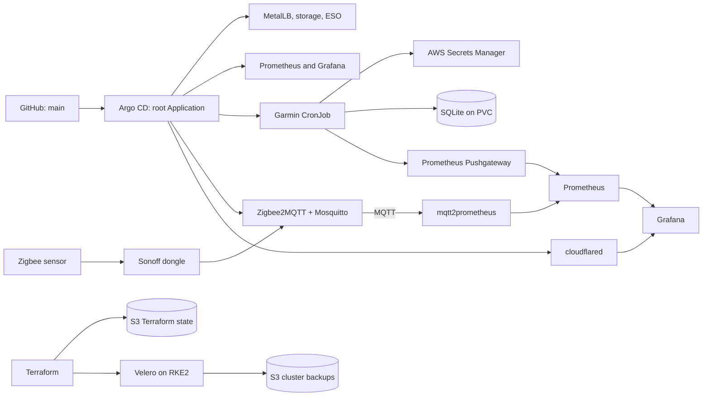
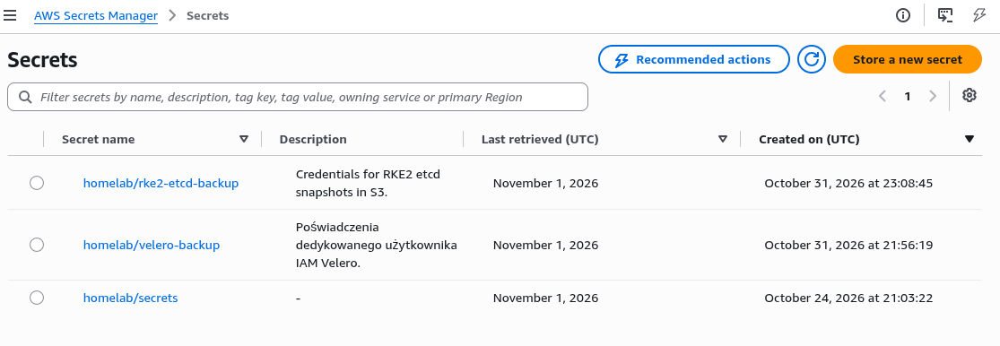
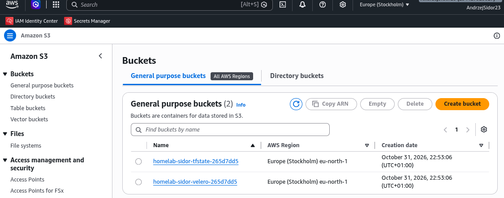
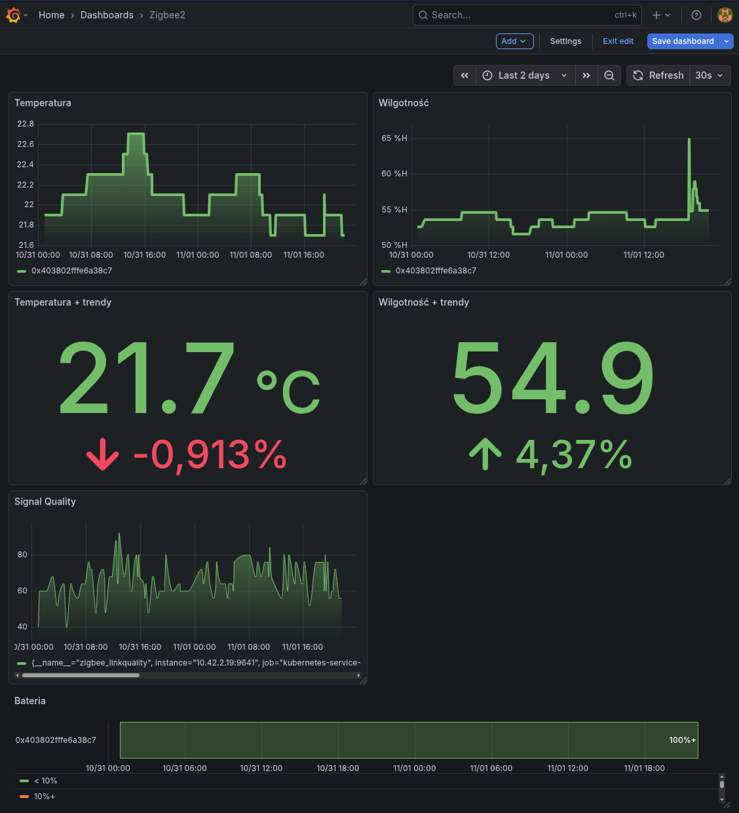
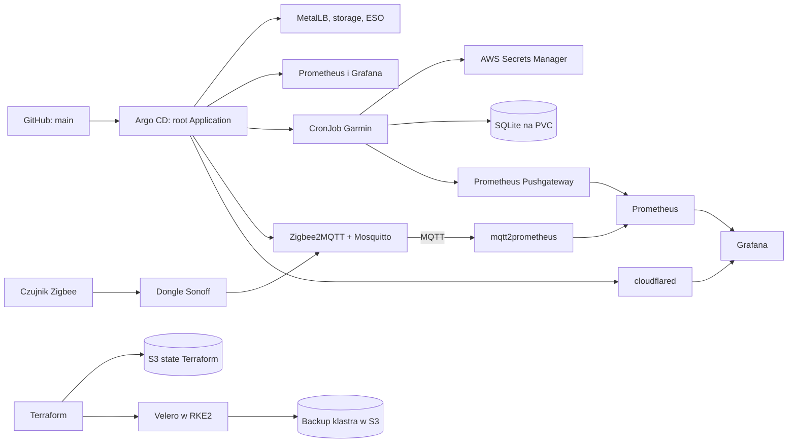

# HomeLab

English | [Polski](#homelab-wersja-polska)

[](https://skillicons.dev)

**Also comfortable with**: SQL (Postgres, SQLite), CI/CD pipelines, Networking and Security (VPC, IAM), ChatGPT, Claude

## Overview

This repository describes a home Kubernetes (RKE2) environment managed declaratively with GitOps. Argo CD watches the `main` branch, deploys applications from Kustomize manifests and keeps the cluster in sync with the repository.

The project combines core cluster services with a Garmin data collector and a smart home stack built on Zigbee2MQTT and an MQTT broker. MetalLB exposes services on a local LAN address pool, Local Path Provisioner provides local volumes, and External Secrets Operator (ESO) syncs selected secrets from AWS Secrets Manager. Prometheus collects metrics that are visualized in Grafana. Zigbee sensors publish measurements over MQTT, and an exporter turns them into Prometheus metrics. Cloudflare Tunnel exposes Grafana, or a single public dashboard, outside the home network without opening router ports.



## Technologies

| Technology | Purpose |
| --- | --- |
| Kubernetes / RKE2 | Runs the cluster services. |
| Argo CD | GitOps and automatic sync of applications from the repository. |
| Argo Rollouts | Progressive delivery controller for Kubernetes Rollout resources. |
| Renovate | Checks dependencies weekly and opens GitHub pull requests; runs as a Kubernetes CronJob. |
| Kustomize | Composes Kubernetes manifests. |
| MetalLB | Exposes `LoadBalancer` services on the LAN. |
| Rancher Local Path Provisioner | Local volumes for applications. |
| External Secrets Operator | Syncs secrets from AWS Secrets Manager. |
| cert-manager | Manages TLS certificates for Kubernetes resources. |
| Traefik | Ingress controller exposed through MetalLB. |
| Istio | Service mesh control plane; workloads opt in to sidecar injection individually. |
| Prometheus and Grafana | Metrics collection and dashboards. |
| Terraform | Manages AWS backup resources and installs Velero in the existing RKE2 cluster. |
| Velero | Backs up Kubernetes resources and mounted PVC data to Amazon S3. |
| Python and Garmin Connect Personal API | Fetches Garmin data, stores it in SQLite and publishes metrics. |
| Zigbee2MQTT | Handles Zigbee sensors through a Sonoff USB dongle and publishes readings to MQTT. |
| Mosquitto (MQTT) | MQTT broker with authentication; credentials come from AWS through ESO. |
| mqtt2prometheus | Converts MQTT readings into Prometheus metrics. |
| Cloudflare Tunnel (`cloudflared`) | Remote access to Grafana without opening router ports. |

## Repository structure

| Path | Contents |
| --- | --- |
| `argocd/root-app.yaml` | Main Argo CD "app of apps" Application. |
| `argocd/kustomization.yaml` | List of applications and infrastructure managed by Argo CD. |
| `argocd/applications/` | Application definitions deployed from this repository. |
| `argocd/infrastructure/` | Cluster services and infrastructure configuration. |
| `k8s/garmin-app/` | CronJob, PVC and secret configuration of the Garmin app. |
| `k8s/zigbee2mqtt/` | Zigbee2MQTT, Mosquitto, the `mqtt2prometheus` exporter and MQTT credentials. |
| `k8s/cloudflared/` | Cloudflare tunnel and the token secret pulled from AWS. |
| `k8s/argocd-access/` | Internal CA, Argo CD TLS certificate and direct MetalLB service. |
| `terraform/` | S3 buckets, remote Terraform state, Velero IAM credentials, and Helm release. |
| `garmin_app.py` | Fetches and stores Garmin data and publishes metrics. |

## GitOps

Once the cluster and Argo CD are ready, start the root application:

```bash
kubectl apply -f argocd/root-app.yaml
```

The root Application watches the `argocd/` directory. To add a new application, put its manifest in `argocd/applications/` or `argocd/infrastructure/` and list it in `argocd/kustomization.yaml`; without that entry Argo CD will not deploy it. Argo CD syncs changes from `main` automatically, removes resources deleted from the configuration (`prune`) and corrects manual drift (`selfHeal`).

## Services

- **Grafana** is exposed through MetalLB at `192.168.0.200`; Prometheus is the default data source. The `Zigbee` and `Garmin` dashboards are provisioned from `argocd/infrastructure/grafana.yaml`.
- **Traefik** is exposed through MetalLB at `192.168.0.202`; use `ingressClassName: traefik` on Ingress resources. Its IngressClass is not the cluster default.
- **Argo CD** is reachable at `https://argocd.andrzejsidor.uk` through Traefik (`192.168.0.202`) or directly at `https://192.168.0.203`. cert-manager issues both DNS and IP SANs from an internal HomeLab CA; trust the CA root certificate on client devices.
- **Istio and Kiali** run in `istio-system`; workloads are not automatically injected and no Istio gateway is installed. Open Kiali at `http://192.168.0.204:20001`. Traefik remains the ingress controller.
- **Argo Rollouts** is installed in namespace `argo-rollouts` with its CRDs. Existing Deployments are unchanged; progressive delivery starts when an application is migrated to a `Rollout` resource.
- **cert-manager** is installed with its CRDs and issues Argo CD's certificate from the internal `homelab-internal-ca` ClusterIssuer. No public ACME issuer is configured.
- **Renovate** runs every Monday at 06:00 Europe/Warsaw in namespace `renovate` and opens PRs for `andsidor/HomeLab`. External Secrets reads the `GIT_KEY` token from `homelab/secrets` in AWS Secrets Manager.
- **Prometheus** keeps metrics for 90 days on a persistent volume (`local-path-retain` class, 10Gi).
- **Zigbee2MQTT** runs on the `debian` node with a Sonoff dongle, and its UI is exposed through MetalLB at `192.168.0.201:8080`. Readings go to the **Mosquitto** MQTT broker on topic `zigbee2mqtt/<device>`, and `mqtt2prometheus` exposes them to Prometheus.
- **MQTT credentials** (`mqtt-user`, `mqtt-password`) live in AWS Secrets Manager (`homelab/secrets`) and reach the cluster as the `mqtt-credentials` secret; anonymous access is disabled.
- **Cloudflare Tunnel** connects the cluster to Cloudflare using a token from AWS (`cloudflared-token`). The public route targets `http://grafana.monitoring.svc.cluster.local:80`; protect it with Cloudflare Access or expose only the public dashboard paths.
- **Garmin** runs as a CronJob every 30 minutes. The Personal API key is synced from AWS by ESO, data goes to SQLite on a PVC, and metrics are pushed to the Pushgateway.
- **Velero** runs in namespace `velero`. It backs up cluster resources and pod-mounted PVC data to S3 every 30 minutes at :07 and :37 UTC, with 7-day retention. File-system backup uses the node-agent; CSI/EBS snapshots are disabled because the cluster uses local-path volumes.

## Screenshots / Zrzuty ekranu

Operational snapshots captured on 2026-11-01; Argo CD statuses and Grafana values change over time. The Secrets Manager image shows names and descriptions only, not secret values. / Zrzuty stanu z 2026-11-01; statusy Argo CD i wartości Grafany zmieniają się w czasie. Obraz Secrets Manager pokazuje tylko nazwy i opisy, bez wartości sekretów.








## Notes and commands

Debugging commands and lessons learned are collected in [HL-NOTE.md](HL-NOTE.md) (Polish and English sections). Never commit secrets or tokens; keep them in AWS Secrets Manager.

## Garmin app (Python)

```bash
pip install -r requirements.txt
python garmin_app.py --days 7 --activities 10 --out garmin_data
python garmin_app.py --download-fit        # also download activity files
```

- Authentication: a personal Garmin Connect Personal API key in `GARMIN_PERSONAL_API_KEY`.
- The API key is exchanged for a bearer token automatically; the token cache is stored in `~/.config/garmin`.
- Create the key in the [Garmin Connect settings](https://connect.garmin.com/app/settings/personalApiToken) and treat it like a password.

## Docker

```bash
docker build -t garmin-app .
docker run -it --rm \
  --env GARMIN_PERSONAL_API_KEY \
  -v "$PWD/garmin_data:/data" \
  garmin-app --days 7
```

## Git / GitHub

```bash
git remote set-url origin https://github.com/andsidor/HomeLab.git
git add . && git commit -m "message" && git push -u origin main
```

## CI (`.github/workflows/ci.yml`)

- `codeql` - Python code analysis
- `python-security` - `bandit -r garmin_app.py`, `pip-audit -r requirements.txt`
- `docker` - build, Trivy (SARIF + gate on CRITICAL only), push to `ghcr.io/andsidor/homelab`

Notes:
- Actions use Node 24 versions (checkout v7, setup-python v7, codeql v4, docker/* v4-v7).
- `aquasecurity/trivy-action` tags have a `v` prefix (e.g. `v0.36.0`).
- HIGH vulnerabilities do not block the build; they are visible in the Security tab.
- Minimum required versions: `urllib3>=2.8.0`, `msgpack>=1.2.1`, `setuptools>=78.1.1` (in the Dockerfile).

## RKE2

```bash
curl -sfL https://get.rke2.io | sudo sh -
sudo systemctl enable --now rke2-server.service

mkdir -p ~/.kube
sudo cp /etc/rancher/rke2/rke2.yaml ~/.kube/config && sudo chown $USER ~/.kube/config
export PATH=$PATH:/var/lib/rancher/rke2/bin
kubectl get nodes

# token for joining nodes (rke2-agent)
sudo cat /var/lib/rancher/rke2/server/node-token
```

## Argo CD

```bash
kubectl create namespace argocd
kubectl apply -n argocd --server-side -f https://raw.githubusercontent.com/argoproj/argo-cd/stable/manifests/install.yaml

# initial password (user: admin)
kubectl -n argocd get secret argocd-initial-admin-secret -o jsonpath="{.data.password}" | base64 -d

# UI: https://localhost:8080
kubectl -n argocd port-forward svc/argocd-server 8080:443
```

Add a new application as an `Application` manifest in `argocd/applications/` or `argocd/infrastructure/`, then list its path in `argocd/kustomization.yaml`. In the manifest set `repoURL` to `https://github.com/andsidor/HomeLab.git` and `path` to the Kustomize directory. Start once with `kubectl apply -f argocd/root-app.yaml`; the root app deploys further applications after their manifests are added to Kustomize and pushed to Git.

Grafana (Helm chart in Argo CD) uses the existing Kubernetes secret `grafana-admin-local` (keys `admin-user` and `admin-password`). Access it with:

```bash
kubectl -n monitoring port-forward svc/grafana 3000:80
```

The UI is then available at `http://localhost:3000`.

Open the Istio dashboard at `http://192.168.0.204:20001` and authenticate with a Kubernetes token.

## External Secrets Operator + AWS

The `aws-secretsmanager` `ClusterSecretStore` connects ESO to AWS Secrets Manager in `eu-north-1` through the existing Kubernetes Secret `awssm-secret` in the `external-secrets` namespace. The store expects the keys `aws_access_key_id` and `aws_secret_access_key` in it; credentials must never be committed to Git.

Use IAM keys with `secretsmanager:GetSecretValue` and `secretsmanager:DescribeSecret`, restricted to the ARNs of the required secrets in `eu-north-1`. With a custom KMS key also add a restricted `kms:Decrypt`. After syncing, check the store with `kubectl get clustersecretstore aws-secretsmanager`.

Secrets Manager inventory (names only; never document secret values):
- `homelab/secrets` contains workload values for Garmin, MQTT, Cloudflare Tunnel and the Renovate classic GitHub token (`GIT_KEY`).
- `homelab/velero-backup` contains the dedicated Velero IAM user's credentials.
- `homelab/rke2-etcd-backup` contains credentials for RKE2 etcd snapshots in S3.

Notes:
- Do not commit secrets (use Sealed Secrets / SOPS / External Secrets).
- A private GHCR package requires an `imagePullSecret` (token with `read:packages`).
- After the first login change the admin password and delete `argocd-initial-admin-secret`.

## Terraform and Velero (AWS)

Terraform manages two separate S3 buckets in `eu-north-1`: `homelab-sidor-tfstate-265d7dd5` for remote state and `homelab-sidor-velero-265d7dd5` for Velero backups. Both use encryption, versioning, public access blocking, and a TLS-only bucket policy. Terraform state is locked with S3 lockfiles. Do not commit `terraform.tfstate`, `.terraform/`, plan files, or credentials.

The bootstrap stack first creates the buckets using a local state, then migrates its state to S3. The Velero stack uses a separate key in the state bucket. AWS access for Terraform uses IAM Identity Center; the dedicated IAM user `homelab-sidor-velero-backup` has access only to the backup bucket. Its key is stored in Secrets Manager (`homelab/velero-backup`) and synced to namespace `velero` by External Secrets. The key value is not stored in Terraform state.

Configure and sign in to the AWS profile:

```bash
aws configure sso --profile homelab
AWS_PROFILE=homelab aws sso login
AWS_PROFILE=homelab aws sts get-caller-identity
```

Create the buckets and migrate the bootstrap state:

```bash
AWS_PROFILE=homelab terraform -chdir=terraform/bootstrap init
AWS_PROFILE=homelab terraform -chdir=terraform/bootstrap plan
AWS_PROFILE=homelab terraform -chdir=terraform/bootstrap apply

cp terraform/bootstrap/backend.tf.example terraform/bootstrap/backend.tf
AWS_PROFILE=homelab terraform -chdir=terraform/bootstrap init -migrate-state -force-copy \
  -backend-config="bucket=$(AWS_PROFILE=homelab terraform -chdir=terraform/bootstrap output -raw state_bucket_name)" \
  -backend-config="key=bootstrap/terraform.tfstate" \
  -backend-config="region=eu-north-1" \
  -backend-config="use_lockfile=true"
```

Plan and install Velero:

```bash
AWS_PROFILE=homelab terraform -chdir=terraform/velero init \
  -backend-config="bucket=$(AWS_PROFILE=homelab terraform -chdir=terraform/bootstrap output -raw state_bucket_name)" \
  -backend-config="key=velero/terraform.tfstate" \
  -backend-config="region=eu-north-1" \
  -backend-config="use_lockfile=true"

AWS_PROFILE=homelab terraform -chdir=terraform/velero plan \
  -var="backup_bucket_name=$(AWS_PROFILE=homelab terraform -chdir=terraform/bootstrap output -raw backup_bucket_name)"

AWS_PROFILE=homelab terraform -chdir=terraform/velero apply \
  -var="backup_bucket_name=$(AWS_PROFILE=homelab terraform -chdir=terraform/bootstrap output -raw backup_bucket_name)"
```

Create the Velero IAM access key once and pipe it directly to Secrets Manager. This requires `jq`; the key is not printed. Do not rerun without checking active keys, because IAM users can have at most two access keys.

```bash
set -o pipefail
AWS_PROFILE=homelab aws iam create-access-key \
  --user-name "$(AWS_PROFILE=homelab terraform -chdir=terraform/velero output -raw velero_iam_user_name)" \
  --output json \
| jq -c '{access_key: .AccessKey.AccessKeyId, secret_access_key: .AccessKey.SecretAccessKey}' \
| AWS_PROFILE=homelab aws secretsmanager put-secret-value \
    --secret-id "$(AWS_PROFILE=homelab terraform -chdir=terraform/velero output -raw velero_credentials_secret_name)" \
    --secret-string file:///dev/stdin
```

Verify Velero and its backup location:

```bash
kubectl -n velero get pods
kubectl -n velero get externalsecret,backupstoragelocation,schedules
kubectl -n velero get backups
```

To run a one-time backup and inspect PVC file-system backups:

```bash
velero backup create manual-check --include-namespaces '*' \
  --include-cluster-resources --default-volumes-to-fs-backup --ttl 168h
velero backup describe manual-check --details
kubectl -n velero get podvolumebackups -l velero.io/backup-name=manual-check -o wide
```

Velero can back up PVC files only when a pod has the volume mounted. The Garmin PVC uses local-path, so Terraform also creates `velero-volume-mounter` in namespace `garmin`. The cluster/resource backup completed, but a `PodVolumeBackup` for `garmin-data` was not confirmed in the validation runs on 2026-10-31. Do not consider Garmin files protected until a completed PVB for `garmin/garmin-data` is visible and a restore to an isolated PVC has been tested. File-system backup reads a live filesystem and is not an atomic SQLite snapshot.

---

# HomeLab (wersja polska)
Repozytorium opisuje domowe środowisko Kubernetes zarządzane deklaratywnie przez GitOps. Argo CD obserwuje gałąź `main`, wdraża aplikacje z manifestów Kustomize i utrzymuje stan klastra zgodny z konfiguracją w repozytorium.

## Przegląd

Projekt łączy podstawowe usługi klastra z aplikacją do pobierania danych Garmin oraz z systemem smart home opartym na Zigbee2MQTT i brokerze MQTT. MetalLB udostępnia usługi przez adresy z lokalnej puli LAN, Local Path Provisioner zapewnia lokalne wolumeny, a External Secrets Operator synchronizuje wybrane sekrety z AWS Secrets Manager. Prometheus zbiera metryki, które można przeglądać w Grafanie. Czujniki Zigbee publikują pomiary przez MQTT, a eksporter zamienia je na metryki Prometheusa. Cloudflare Tunnel pozwala bezpiecznie udostępnić Grafanę lub wybrany dashboard poza siecią domową.



## Technologie

| Technologia | Zastosowanie |
| --- | --- |
| Kubernetes / RKE2 | Uruchamianie usług klastra; instrukcje instalacji znajdują się niżej. |
| Argo CD | GitOps i automatyczna synchronizacja aplikacji z repozytorium. |
| Argo Rollouts | Kontroler wdrożeń progresywnych dla zasobów Kubernetes `Rollout`. |
| Renovate | Cotygodniowo sprawdza zależności i otwiera pull requesty GitHuba; działa jako Kubernetes CronJob. |
| Kustomize | Składanie manifestów Kubernetes. |
| MetalLB | Udostępnianie usług typu `LoadBalancer` w sieci LAN. |
| Rancher Local Path Provisioner | Lokalne wolumeny dla aplikacji. |
| External Secrets Operator | Synchronizacja sekretów z AWS Secrets Manager. |
| cert-manager | Zarządzanie certyfikatami TLS dla zasobów Kubernetes. |
| Traefik | Kontroler Ingress udostępniony przez MetalLB. |
| Istio | Control plane service mesh; workloady dołączają do sidecar injection indywidualnie. |
| Prometheus i Grafana | Zbieranie oraz przeglądanie metryk. |
| Terraform | Zarządzanie zasobami AWS do backupu i instalacja Velero w istniejącym klastrze RKE2. |
| Velero | Backup zasobów Kubernetes i danych zamontowanych PVC do Amazon S3. |
| Python i Garmin Connect Personal API | Pobieranie danych Garmin, zapis w SQLite i publikowanie metryk. |
| Zigbee2MQTT | Obsługa czujników Zigbee przez dongle USB Sonoff i publikowanie pomiarów w MQTT. |
| Mosquitto (MQTT) | Broker wiadomości MQTT z logowaniem; dane logowania pochodzą z AWS przez ESO. |
| mqtt2prometheus | Zamiana pomiarów z MQTT na metryki Prometheusa. |
| Cloudflare Tunnel (`cloudflared`) | Zdalny dostęp do Grafany bez otwierania portów w routerze. |

## Struktura repozytorium

| Ścieżka | Zawartość |
| --- | --- |
| `argocd/root-app.yaml` | Główna aplikacja Argo CD typu „app of apps”. |
| `argocd/kustomization.yaml` | Lista aplikacji i elementów infrastruktury zarządzanych przez Argo CD. |
| `argocd/applications/` | Definicje aplikacji wdrażanych z tego repozytorium. |
| `argocd/infrastructure/` | Konfiguracja usług i infrastruktury klastra. |
| `k8s/garmin-app/` | CronJob, PVC i konfiguracja sekretu aplikacji Garmin. |
| `k8s/zigbee2mqtt/` | Zigbee2MQTT, Mosquitto, eksporter `mqtt2prometheus` i dane logowania MQTT. |
| `k8s/cloudflared/` | Tunel Cloudflare i sekret z tokenem pobierany z AWS. |
| `k8s/argocd-access/` | Wewnętrzny CA, certyfikat TLS Argo CD i bezpośrednia usługa MetalLB. |
| `terraform/` | Buckety S3, zdalny state Terraform, uprawnienia Velero i release Helm. |
| `garmin_app.py` | Pobieranie i zapisywanie danych Garmin oraz publikowanie metryk. |

## GitOps

Po przygotowaniu klastra i Argo CD uruchom główną aplikację:

```bash
kubectl apply -f argocd/root-app.yaml
```

Root Application obserwuje katalog `argocd/`. Dodanie nowej aplikacji wymaga dodania jej manifestu do `argocd/applications/` lub `argocd/infrastructure/` i dopisania go do `argocd/kustomization.yaml`. Argo CD automatycznie synchronizuje zmiany z gałęzi `main`, w tym usuwa zasoby usunięte z konfiguracji (`prune`) i koryguje ręczne rozbieżności (`selfHeal`).

## Usługi

- **Grafana** jest udostępniana przez MetalLB pod adresem `192.168.0.200`; domyślnym źródłem danych jest Prometheus. Dashboardy `Zigbee` i `Garmin` są provisionowane z `argocd/infrastructure/grafana.yaml`.
- **Traefik** jest udostępniony przez MetalLB pod adresem `192.168.0.202`; zasoby Ingress powinny wskazywać `ingressClassName: traefik`. Klasa Traefika nie jest domyślną klasą klastra.
- **Argo CD** jest dostępne pod `https://argocd.andrzejsidor.uk` przez Traefika (`192.168.0.202`) albo bezpośrednio pod `https://192.168.0.203`. cert-manager wystawia SAN dla nazwy DNS i IP z wewnętrznego CA HomeLab; zaufaj certyfikatowi root CA na urządzeniach klienckich.
- **Istio i Kiali** działają w namespace `istio-system`; workloads nie są automatycznie wstrzykiwane, a gateway Istio nie jest zainstalowany. Panel Kiali jest dostępny pod `http://192.168.0.204:20001`; logowanie odbywa się tokenem Kubernetes. Kontrolerem Ingress pozostaje Traefik.
- **Argo Rollouts** jest zainstalowany w namespace `argo-rollouts` razem z CRD. Istniejące Deploymenty pozostają bez zmian; wdrożenia progresywne wymagają migracji aplikacji do zasobu `Rollout`.
- **cert-manager** jest zainstalowany razem z CRD i wystawia certyfikat Argo CD przez wewnętrzny ClusterIssuer `homelab-internal-ca`. Publiczny issuer ACME nie jest skonfigurowany.
- **Renovate** działa w namespace `renovate` w każdy poniedziałek o 06:00 czasu Europe/Warsaw i otwiera PR-y dla `andsidor/HomeLab`. External Secrets pobiera z AWS token `GIT_KEY` z `homelab/secrets`.
- **Prometheus** przechowuje metryki przez 90 dni na trwałym wolumenie (klasa `local-path-retain`, 10Gi).
- **Zigbee2MQTT** działa na węźle `debian` z donglem Sonoff, a panel jest dostępny przez MetalLB pod `192.168.0.201:8080`. Pomiary trafiają do brokera **Mosquitto** (MQTT) w temacie `zigbee2mqtt/<urządzenie>`, a `mqtt2prometheus` udostępnia je Prometheusowi.
- **Cloudflare Tunnel** łączy klaster z Cloudflare przez token z AWS; trasa publiczna wskazuje na Grafanę, a dostęp warto chronić przez Cloudflare Access.
- **Garmin** działa jako CronJob co 30 minut. Klucz Personal API jest synchronizowany z AWS przez ESO, dane trafiają do SQLite na PVC, a metryki są wysyłane do Pushgateway.
- **Velero** działa w namespace `velero`. Co 30 minut, o :07 i :37 UTC, zapisuje zasoby klastra i dane PVC zamontowane w podach do S3; retencja wynosi 7 dni. Backup plikowy wykorzystuje node-agent; snapshoty CSI/EBS są wyłączone, ponieważ klaster używa wolumenów local-path.

## Notatki i komendy

Aplikacja `garmin_app.py` pobiera dane z Garmin Connect Personal API.

## Aplikacja Garmin (Python)

```bash
pip install -r requirements.txt
python garmin_app.py --days 7 --activities 10 --out garmin_data
python garmin_app.py --download-fit        # dodatkowo pliki aktywności
```

- Uwierzytelnianie: osobisty klucz Garmin Connect Personal API w `GARMIN_PERSONAL_API_KEY`.
- Klucz API wymienia się automatycznie na bearer token; cache tokenu trafia do `~/.config/garmin`.
- Klucz Personal API utworzysz w [ustawieniach Garmin Connect](https://connect.garmin.com/app/settings/personalApiToken). Traktuj go jak hasło.

## Docker

```bash
docker build -t garmin-app .
docker run -it --rm \
  --env GARMIN_PERSONAL_API_KEY \
  -v "$PWD/garmin_data:/data" \
  garmin-app --days 7
```

## Git / GitHub

```bash
git remote set-url origin https://github.com/andsidor/HomeLab.git
git add . && git commit -m "opis" && git push -u origin main
```

## CI (`.github/workflows/ci.yml`)

- `codeql` - analiza kodu Pythona
- `python-security` - `bandit -r garmin_app.py`, `pip-audit -r requirements.txt`
- `docker` - build, Trivy (SARIF + bramka tylko na CRITICAL), push do `ghcr.io/andsidor/homelab`

Notatki:
- Akcje w wersjach Node 24 (checkout v7, setup-python v7, codeql v4, docker/* v4-v7).
- Tagi `aquasecurity/trivy-action` mają prefiks `v` (np. `v0.36.0`).
- Podatności HIGH nie blokują builda, są widoczne w zakładce Security.
- Wymagane minimalne wersje: `urllib3>=2.8.0`, `msgpack>=1.2.1`, `setuptools>=78.1.1` (w Dockerfile).

## RKE2

```bash
curl -sfL https://get.rke2.io | sudo sh -
sudo systemctl enable --now rke2-server.service

mkdir -p ~/.kube
sudo cp /etc/rancher/rke2/rke2.yaml ~/.kube/config && sudo chown $USER ~/.kube/config
export PATH=$PATH:/var/lib/rancher/rke2/bin
kubectl get nodes

# token do dołączania węzłów (rke2-agent)
sudo cat /var/lib/rancher/rke2/server/node-token
```

## Argo CD

```bash
kubectl create namespace argocd
kubectl apply -n argocd --server-side -f https://raw.githubusercontent.com/argoproj/argo-cd/stable/manifests/install.yaml

# hasło początkowe (użytkownik: admin)
kubectl -n argocd get secret argocd-initial-admin-secret -o jsonpath="{.data.password}" | base64 -d

# panel: https://localhost:8080
kubectl -n argocd port-forward svc/argocd-server 8080:443
```

Nową aplikację dodaj jako manifest `Application` w `argocd/applications/`
albo `argocd/infrastructure/`, a następnie dopisz jej ścieżkę do
`argocd/kustomization.yaml`. W manifeście ustaw `repoURL` na
`https://github.com/andsidor/HomeLab.git` i `path` na katalog z Kustomize.

Struktura w repo:
- `argocd/root-app.yaml` - Application "app of apps", obserwuje `argocd/`
- `argocd/kustomization.yaml` - lista aplikacji oraz elementów infrastruktury zarządzanych przez root app
- `argocd/applications/` - po jednym Application na aplikację
- `argocd/infrastructure/` - aplikacje i konfiguracja elementów klastra
- `k8s/<app>/` - manifesty (Kustomize)

Start (raz): `kubectl apply -f argocd/root-app.yaml`; kolejne aplikacje wdroży root app po dodaniu manifestu do Kustomize i wysłaniu zmian do Gita.

Grafana (Helm chart w Argo CD) korzysta z istniejącego sekretu Kubernetes `grafana-admin-local`. Po synchronizacji:

```bash
kubectl -n monitoring port-forward svc/grafana 3000:80
```

Panel będzie dostępny pod `http://localhost:3000`. AWS secret `homelab/monitoring/grafana-admin` powinien być obiektem JSON z polami `admin-user` i `admin-password`.

Dashboard Istio (Kiali) jest dostępny po synchronizacji pod `http://192.168.0.204:20001`. Zaloguj się tokenem Kubernetes.

## External Secrets Operator + AWS

`ClusterSecretStore` `aws-secretsmanager` łączy ESO z AWS Secrets Manager w regionie `eu-north-1` przez istniejący Kubernetes Secret `awssm-secret` w namespace `external-secrets`. Store oczekuje w nim kluczy `aws_access_key_id` i `aws_secret_access_key`; wartości credentiali nie powinny trafiać do Gita.

Użyj kluczy IAM z uprawnieniami `secretsmanager:GetSecretValue` i `secretsmanager:DescribeSecret`, ograniczonymi do ARN potrzebnych sekretów w `eu-north-1`. Przy własnym kluczu KMS dodaj także ograniczone `kms:Decrypt`. Po synchronizacji sprawdź store: `kubectl get clustersecretstore aws-secretsmanager`.

Sekrety w Secrets Manager (same nazwy; nigdy nie dokumentuj ich wartości):
- `homelab/secrets` zawiera dane workloadów Garmin, MQTT, Cloudflare Tunnel oraz classic GitHub PAT dla Renovate (`GIT_KEY`).
- `homelab/velero-backup` zawiera poświadczenia dedykowanego użytkownika IAM dla Velero.
- `homelab/rke2-etcd-backup` zawiera poświadczenia do zapisu snapshotów etcd RKE2 w S3.

`k8s/garmin-app/cronjob.yaml` pobiera dane z Garmin Connect Personal API; klucz pochodzi z AWS przez ESO, a SQLite i cache bearer tokenu są przechowywane na PVC.

Uwagi:
- Sekretów nie commitować (Sealed Secrets / SOPS / External Secrets).
- Prywatny pakiet GHCR wymaga `imagePullSecret` (token `read:packages`).
- Po zalogowaniu zmienić hasło admina i usunąć `argocd-initial-admin-secret`.

## Terraform i Velero (AWS)

Terraform zarządza dwoma osobnymi bucketami S3 w `eu-north-1`: `homelab-sidor-tfstate-265d7dd5` przechowuje zdalny state, a `homelab-sidor-velero-265d7dd5` backupy Velero. Oba mają szyfrowanie, wersjonowanie, blokadę publicznego dostępu i politykę wymuszającą TLS. Blokada state używa S3 lockfiles. Nie commituj `terraform.tfstate`, `.terraform/`, planów ani credentiali.

Stos bootstrap najpierw tworzy buckety z lokalnym state, a następnie migruje state do S3. Stos Velero używa osobnego klucza w bucketcie state. Terraform loguje się przez IAM Identity Center. Dedykowany IAM user `homelab-sidor-velero-backup` ma dostęp tylko do bucketa backupowego. Jego klucz jest zapisany w Secrets Manager (`homelab/velero-backup`) i synchronizowany przez External Secrets do namespace `velero`; wartość klucza nie trafia do Terraform state.

Konfiguracja i logowanie profilu AWS:

```bash
aws configure sso --profile homelab
AWS_PROFILE=homelab aws sso login
AWS_PROFILE=homelab aws sts get-caller-identity
```

Utworzenie bucketów i migracja state bootstrapu:

```bash
AWS_PROFILE=homelab terraform -chdir=terraform/bootstrap init
AWS_PROFILE=homelab terraform -chdir=terraform/bootstrap plan
AWS_PROFILE=homelab terraform -chdir=terraform/bootstrap apply

cp terraform/bootstrap/backend.tf.example terraform/bootstrap/backend.tf
AWS_PROFILE=homelab terraform -chdir=terraform/bootstrap init -migrate-state -force-copy \
  -backend-config="bucket=$(AWS_PROFILE=homelab terraform -chdir=terraform/bootstrap output -raw state_bucket_name)" \
  -backend-config="key=bootstrap/terraform.tfstate" \
  -backend-config="region=eu-north-1" \
  -backend-config="use_lockfile=true"
```

Plan i instalacja Velero:

```bash
AWS_PROFILE=homelab terraform -chdir=terraform/velero init \
  -backend-config="bucket=$(AWS_PROFILE=homelab terraform -chdir=terraform/bootstrap output -raw state_bucket_name)" \
  -backend-config="key=velero/terraform.tfstate" \
  -backend-config="region=eu-north-1" \
  -backend-config="use_lockfile=true"

AWS_PROFILE=homelab terraform -chdir=terraform/velero plan \
  -var="backup_bucket_name=$(AWS_PROFILE=homelab terraform -chdir=terraform/bootstrap output -raw backup_bucket_name)"

AWS_PROFILE=homelab terraform -chdir=terraform/velero apply \
  -var="backup_bucket_name=$(AWS_PROFILE=homelab terraform -chdir=terraform/bootstrap output -raw backup_bucket_name)"
```

Utwórz klucz IAM Velero tylko raz i przekaż go potokiem bezpośrednio do Secrets Manager. Wymaga to `jq`; klucz nie jest wypisywany. Nie uruchamiaj ponownie bez sprawdzenia aktywnych kluczy, ponieważ IAM user może mieć maksymalnie dwa.

```bash
set -o pipefail
AWS_PROFILE=homelab aws iam create-access-key \
  --user-name "$(AWS_PROFILE=homelab terraform -chdir=terraform/velero output -raw velero_iam_user_name)" \
  --output json \
| jq -c '{access_key: .AccessKey.AccessKeyId, secret_access_key: .AccessKey.SecretAccessKey}' \
| AWS_PROFILE=homelab aws secretsmanager put-secret-value \
    --secret-id "$(AWS_PROFILE=homelab terraform -chdir=terraform/velero output -raw velero_credentials_secret_name)" \
    --secret-string file:///dev/stdin
```

Weryfikacja Velero i lokalizacji backupu:

```bash
kubectl -n velero get pods
kubectl -n velero get externalsecret,backupstoragelocation,schedules
kubectl -n velero get backups
```

Jednorazowy backup i kontrola plikowych kopii PVC:

```bash
velero backup create manual-check --include-namespaces '*' \
  --include-cluster-resources --default-volumes-to-fs-backup --ttl 168h
velero backup describe manual-check --details
kubectl -n velero get podvolumebackups -l velero.io/backup-name=manual-check -o wide
```

Velero kopiuje pliki PVC tylko wtedy, gdy pod ma zamontowany wolumen. PVC Garmina używa local-path, dlatego Terraform tworzy też `velero-volume-mounter` w namespace `garmin`. Backup zasobów klastra zakończył się, ale w testach z 2026-10-31 nie potwierdzono `PodVolumeBackup` dla `garmin-data`. Nie uznawaj plików Garmin za zabezpieczone, dopóki nie pojawi się ukończony PVB dla `garmin/garmin-data` i nie zostanie przetestowane odtworzenie na odizolowanym PVC. Backup plikowy czyta aktywny system plików i nie jest atomowym snapshotem SQLite.
