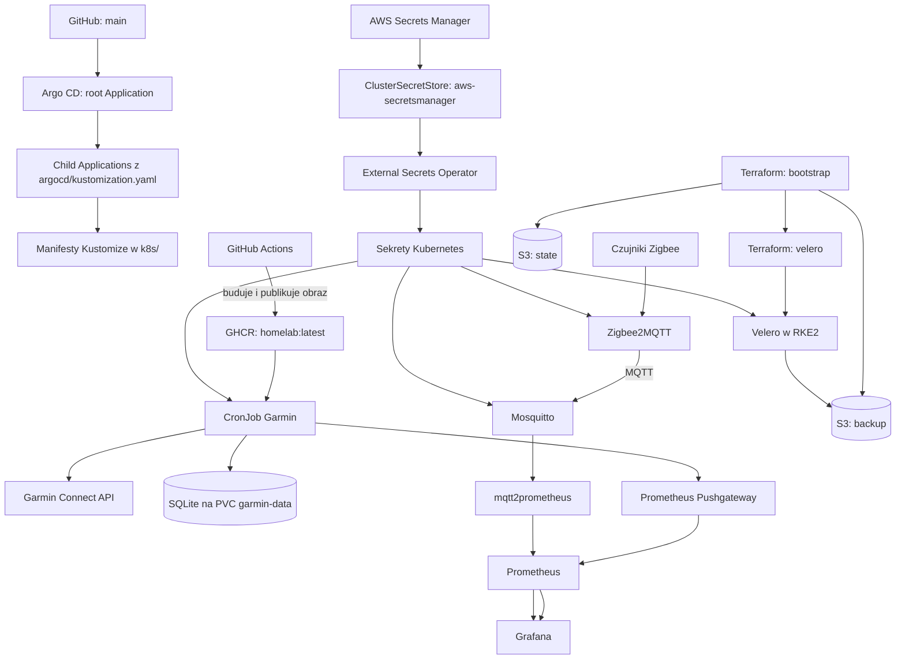
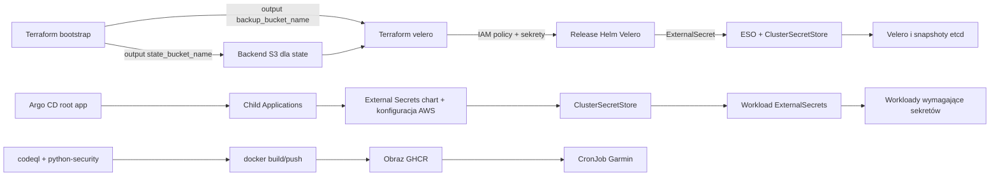

# Mapa zmiennych i zależności

Dokument opisuje konfigurację wejściową repozytorium i przepływ zależności między GitHub Actions, Argo CD, Kubernetes, External Secrets Operator (ESO) oraz Terraform/AWS. Wartości sekretów pozostają poza repozytorium.

## Przepływ systemu

## Wejścia Terraform

### `terraform/bootstrap`

| Zmienna | Domyślna wartość | Znaczenie i zależności |
| --- | --- | --- |
| `aws_region` | `eu-north-1` | Region providera AWS i bucketów. |
| `name_prefix` | `homelab-sidor` | Prefiks nazw bucketów; walidacja dopuszcza 3–32 małe litery, cyfry i myślniki. |
| `random_id.suffix.hex` | generowana | 8-znakowy sufiks dodawany do nazwy każdego bucketa, by zapewnić globalną unikalność. To zasób losowy, nie zmienna wejściowa. |

`local.bucket_names` łączy prefiks i sufiks, tworząc bucket stanu oraz bucket backupów. `state_bucket_name` i `backup_bucket_name` są outputami używanymi przy konfiguracji backendu i stosu `velero`.

### `terraform/velero`

| Zmienna | Domyślna wartość | Znaczenie i zależności |
| --- | --- | --- |
| `aws_region` | `eu-north-1` | Region AWS; jest używany przez providera, konfigurację backupu Velero i sekret snapshotów etcd. Powinien odpowiadać regionowi zasobów bootstrap. |
| `backup_bucket_name` | brak; wymagany | Nazwa bucketa z outputu `terraform/bootstrap`; zakres zasobów IAM i konfiguracja Velero/RKE2. |
| `credentials_secret_name` | `homelab/velero-backup` | Nazwa sekretu Secrets Manager dla klucza IAM Velero. |
| `rke2_credentials_secret_name` | `homelab/rke2-etcd-backup` | Nazwa sekretu Secrets Manager dla klucza snapshotów etcd RKE2. |
| `name_prefix` | `homelab-sidor` | Prefiks nazw użytkowników i polityk IAM; powinien być zgodny z wartością w bootstrap. |
| `kubeconfig_path` | `~/.kube/config` | Kubeconfig klastra RKE2 używany przez providera Helm. `~` jest rozwijane przez `pathexpand`. |
| `backup_schedule` | `7,37 * * * *` | Cron w UTC dla harmonogramu Velero. |
| `backup_ttl` | `168h` | Retencja backupów Velero (7 dni), używana w ustawieniach chartu. |

Backend S3 nie pobiera tych wartości ze zmiennych Terraform: `init` dostaje bucket, klucz stanu, region i `use_lockfile` przez `-backend-config`. Stos Velero wymaga najpierw outputu bucketa ze stosu bootstrap.

## Sekrety i ich konsumenci

| Źródło w AWS Secrets Manager | Pole źródłowe | Sekret Kubernetes i klucz | Konsument |
| --- | --- | --- | --- |
| `homelab/secrets` | `garmin-api` | `garmin/garmin-api-token:garmin-personal-api-key` | CronJob Garmin jako `GARMIN_PERSONAL_API_KEY`. |
| `homelab/secrets` | `cloudflared-token` | `cloudflared/cloudflared-token:token` | Deployment `cloudflared` jako `TUNNEL_TOKEN`. |
| `homelab/secrets` | `mqtt-user`, `mqtt-password` | `zigbee2mqtt/mqtt-credentials:user`, `password` | Zigbee2MQTT, inicjalizacja Mosquitto i `mqtt2prometheus`. |
| `homelab/secrets` | `GIT_KEY` | `renovate/renovate-github-token:token` | CronJob Renovate jako `RENOVATE_TOKEN`. |
| `homelab/secrets` | `admin-user`, `admin-password` | `monitoring/grafana-admin-local:admin-user`, `admin-password` | Dane administratora Grafany. ESO scala je z istniejącym sekretem (`creationPolicy: Merge`). |
| `homelab/secrets` | `smtp-auth-password` | `monitoring/alertmanager-smtp:smtp-auth-password` | Uwierzytelnienie SMTP Alertmanagera. |
| `homelab/velero-backup` | `access_key`, `secret_access_key` | `velero/velero-aws-credentials:cloud` | Dane AWS Velero. Terraform tworzy ExternalSecret, a template ESO buduje z pól plik `cloud`. |
| `homelab/rke2-etcd-backup` | `access_key`, `secret_access_key` | `kube-system/rke2-etcd-s3-config` | Konfiguracja S3 snapshotów etcd RKE2, w tym bucket, region i prefiks ustawiane przez Terraform. |

Wszystkie powyższe ExternalSecret korzystają z `ClusterSecretStore` `aws-secretsmanager`. Store wymaga wcześniej istniejącego sekretu Kubernetes `external-secrets/awssm-secret` z kluczami `access-key` i `secret-access-key`; jego wartości nie są zarządzane w tym repozytorium. AWS Secrets Manager, sekret uwierzytelniający store i polityka IAM muszą być dostępne przed synchronizacją sekretów.

## Konfiguracja workloadów

| Workload | Zmienne / parametry | Źródło lub efekt |
| --- | --- | --- |
| Garmin | `GARMIN_PERSONAL_API_KEY` | `garmin-api-token` z ESO. Wymagana do autoryzacji Garmin Connect. |
| Garmin | `PROMETHEUS_PUSHGATEWAY` | Adres Pushgateway ustawiony w CronJobie; jeżeli zmienna jest pominięta, aplikacja nie publikuje metryk. |
| Garmin | `HOME=/data` | Katalog domowy i cache tokenu; PVC `garmin-data` jest montowany pod `/data`. |
| Garmin | `--days 20`, `--start-date 2026-08-28` | Argumenty CronJoba. Pozostałe opcje CLI: `--out` (domyślnie `garmin_data`), `--activities` (domyślnie `100`) i `--download-fit` (domyślnie wyłączone); bez `--start-date` aplikacja wyznacza początek na podstawie zapisanych danych lub `--days` (domyślnie `90`). |
| Zigbee2MQTT | `TZ=Europe/Warsaw` | Wartość ustawiona w manifeście. |
| Zigbee2MQTT | `ZIGBEE2MQTT_CONFIG_MQTT_USER`, `ZIGBEE2MQTT_CONFIG_MQTT_PASSWORD` | Klucze `user` i `password` z `mqtt-credentials`. |
| Mosquitto | `MQTT_USER`, `MQTT_PASSWORD` | Te same klucze z `mqtt-credentials`; init container tworzy plik haseł. |
| `mqtt2prometheus` | `MQTT2PROM_MQTT_USER`, `MQTT2PROM_MQTT_PASSWORD` | Te same klucze z `mqtt-credentials`; połączenie z brokerem `mosquitto:1883`. |
| cloudflared | `TUNNEL_TOKEN` | Klucz `token` z `cloudflared-token`. |
| Renovate (CronJob Kubernetes) | `RENOVATE_PLATFORM=github`, `RENOVATE_REPOSITORIES=andsidor/HomeLab` | Stałe wartości w manifeście; `RENOVATE_TOKEN` pochodzi z `renovate-github-token`. |
| Alloy | `NODE_NAME` | Wartość z pola Kubernetes `spec.nodeName` przez Downward API; ogranicza odkrywanie podów do bieżącego węzła. |
| CI GitHub Actions | `secrets.RENOVATE_APP_ID`, `secrets.RENOVATE_PRIVATE_KEY` | Sekrety repozytorium/organizacji wymagane przez workflow `.github/workflows/Renovate.yaml`; wynikowy token GitHub App trafia do akcji Renovate. |
| CI GitHub Actions | `secrets.GITHUB_TOKEN`, `github.actor`, `github.repository` | Token dostarczany przez GitHub i kontekst zdarzenia; logowanie/publikacja obrazu do GHCR odbywają się poza zdarzeniem `pull_request`. |

## Zależności i kolejność

- `argocd/root-app.yaml` wskazuje na `argocd/`, a `argocd/kustomization.yaml` deklaruje aplikacje potomne. Dodanie manifestu w `k8s/` nie wdraża go samo — odpowiednia aplikacja musi być wymieniona w Kustomize i zarejestrowana w root Kustomization.
- Aplikacje potomne synchronizują się automatycznie, ale manifesty nie definiują kolejności synchronizacji ani `sync waves`/`dependsOn`. W szczególności dostępność ESO/CRD, `ClusterSecretStore`, źródłowych sekretów AWS i storage class musi poprzedzać działanie zależnych workloadów; kontrolery mogą ponawiać synchronizację, ale nie jest to jawna bariera kolejności.
- CronJob Garmin wymaga sekretu API i PVC; publikuje metryki do skonfigurowanego Pushgateway. Obraz `ghcr.io/andsidor/homelab:latest` jest budowany i publikowany przez workflow CI dla push/schedule; publikacja nie zachodzi przy `pull_request`.
- Zigbee2MQTT wymaga `mqtt-credentials`, PVC i przypiętego węzła `debian` z urządzeniem `/dev/ttyUSB0`. Mosquitto i exporter używają tego samego sekretu; exporter łączy się z usługą Mosquitto.
- Stos `terraform/velero` zależy od utworzonych przez bootstrap bucketów i dostępnego kubeconfigu. Zależności między zasobami AWS oraz release Helm są modelowane referencjami Terraform i `depends_on`; założenie backendu S3 wymaga osobnego `terraform init`.
- CI buduje obraz dopiero po pomyślnym `codeql` i `python-security`; skan Trivy raportuje wyniki SARIF, ale obecnie nie blokuje builda.

## Gdzie aktualizować mapę

- Zmienne Terraform: `terraform/bootstrap/main.tf` i `terraform/velero/main.tf`.
- Sekrety i ich mapowanie: pliki `*externalsecret*.yaml`, `external-secret.yaml` oraz `argocd/infrastructure/external-secrets-aws/`.
- Zmienne workloadów i argumenty: manifesty `k8s/` oraz `garmin_app.py`.
- Sekrety CI i kolejność jobów: `.github/workflows/`.

Po zmianie nazw kluczy sekretów, zmiennych Terraform albo referencji między workloadami zaktualizuj odpowiedni wpis w tej mapie.
